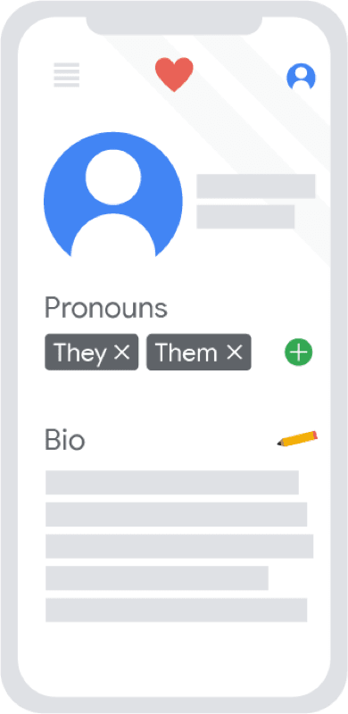
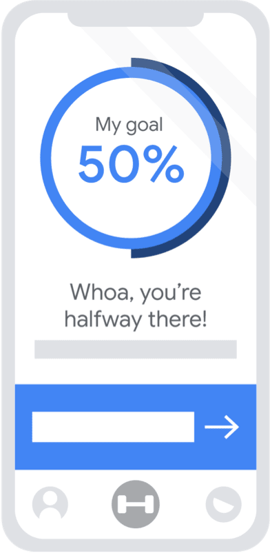
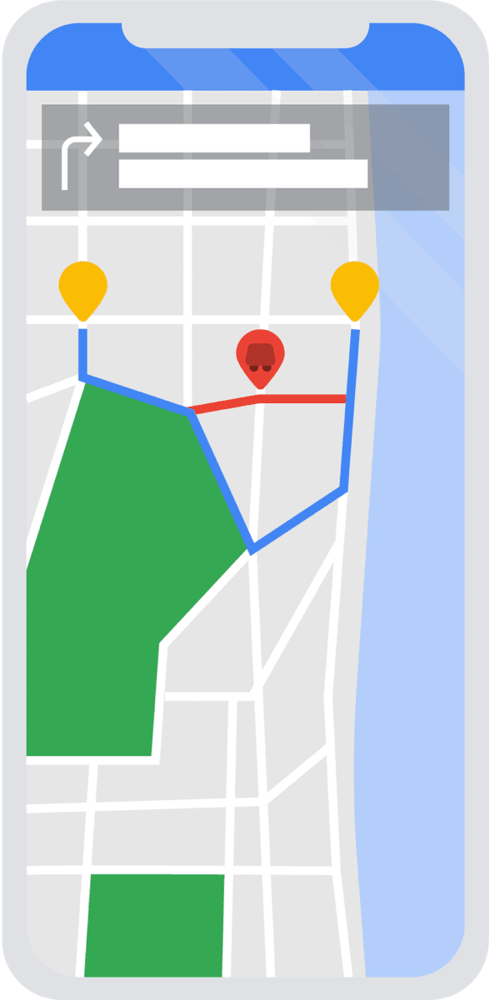

# Conozca el diseño de la experiencia del usuario

## Bienvenido al Módulo 1
- Hola de nuevo y bienvenidos a la primera semana del programa.
- ​Espero que estés tan ​entusiasmado como yo por empezar.
- ​Al principio de cada semana, ​puede esperar un vídeo como este, ​de mí o de uno de mis colegas.
- ​Le daremos un breve resumen de ​lo que puede esperar aprender esa semana.
- ​Esta semana exploraremos cómo funciona este programa.
- ​Luego, abordaremos la definición de diseño de UX y ​por qué el diseño de UX es importante para los consumidores y las empresas.
- ​También analizaremos las diferentes funciones ​en el campo de la UX, ​qué hace que la experiencia del usuario sea buena o mala, ​las responsabilidades de los diseñadores de UX principiantes, cómo los diseñadores de ​UX trabajan con equipos multifuncionales, las diferencias ​en los trabajos de diseño de UX ​según el tamaño de la empresa y el sector, ​y cómo seguir una carrera en el diseño de UX.
- ​Como puede ver, nos queda mucho ​por aprender. Vamos a empezar. 

---

## Los fundamentos del diseño de la experiencia del usuario
- Hola de nuevo.
- Anteriormente analizamos cómo los diseñadores de UX ​ayudan a que la tecnología sea más fácil de ​entender y más agradable de usar.
- ​En este vídeo, definiremos la ​experiencia del usuario y el diseño de UX.
- ​Revisaremos por qué el diseño de UX es ​importante para los consumidores y las empresas.
- Vamos a empezar.
- ​La experiencia del usuario es cómo se ​siente una persona, el usuario, al interactuar con ​un producto o experimentarlo.
- ​Un producto es un bien, un servicio o una función.
- ​Puede ser un producto físico, ​como un mando de videojuegos ​o una bolsa de patatas fritas, ​o un producto tecnológico, como ​una aplicación, un sitio web o un reloj inteligente.
- ​Hay muchas cosas que pueden contribuir ​a una buena experiencia del usuario.
- ​En este vídeo, destacaremos algunos de ellos.
- ​Por ejemplo, para que un usuario tenga una buena experiencia, ​el producto debe ser utilizable, ​equitativo, agradable y útil.
- ​Vamos a desglosar eso.
- ​Para empezar, la experiencia del usuario consiste en mejorar la ​usabilidad o hacer que algo sea más fácil de usar.
- ​Esto significa que el diseño​, la estructura y el propósito ​del producto son claros para todos.
- ​Piensa en una botella de ketchup.
- ​Históricamente, el ketchup venía en una botella de vidrio.
- ​El usuario tuvo que golpear el fondo ​del vaso para que saliera el ketchup.
- ​A menudo, no ​sale salsa de tomate o demasiado de la botella.
- ​Hoy en día, la botella de salsa de tomate se ha ​rediseñado para convertirla en una botella de plástico que se puede comprimir, lo ​que facilita su uso y permite ​a los usuarios controlar la cantidad de salsa de tomate que sale.
- ​Los diseñadores de UX deben pensar en ​cada persona que usa el producto.
- ​Esto puede incluir ​a personas con discapacidades o personas con ​experiencias de vida muy diferentes a las suyas.
- ​Por ejemplo, un usuario puede encontrar una aplicación con mucho texto fácil de usar.
- ​Por otro lado, un usuario con ​discapacidad visual puede querer funciones diferentes, como el sonido.
- ​Tener en cuenta las necesidades únicas de muchas personas diferentes es un ​trabajo importante y ​pensar en un diseño equitativo es clave.
- ​Ser equitativo significa que sus diseños son útiles ​y comercializables para personas con diversas habilidades y antecedentes.
- ​La experiencia del usuario también ​consiste en hacer que las cosas sean agradables de usar, ​lo que crea una conexión positiva ​entre el usuario y el producto.
- ​Los diseñadores de UX fomentan esa conexión positiva al ​tener en cuenta los pensamientos y sentimientos del usuario al crear productos.
- ​Piense en pedir comida para llevar en línea.
- ​Cuando buscas un restaurante en Google o Yelp, ​puedes ver fotos de platos y ​leer reseñas de otras personas que han comido allí.
- ​Esta experiencia es agradable porque puedes ​tomar una decisión más informada sobre qué pedir, lo ​que te hace sentir más satisfecho con el producto.
- ​Entonces, ¿cómo podemos averiguar qué es lo que hace que un usuario esté satisfecho con el producto?
- ​Ahí es donde entra en juego la investigación.
- ​Para saber cómo se sienten los usuarios, ​tenemos que recopilar pruebas sobre cómo están experimentando ​ese producto en tiempo real y preguntarles también sobre él.
- ​Discutiremos esto con mucho más detalle más adelante.
- ​Como seres humanos, queremos productos que sean útiles, es ​decir, que resuelvan nuestros problemas.
- ​Por ejemplo, si estás perdido, es ​útil contar con una aplicación de mapas que te diga cómo llegar a casa.
- ​Pero si la aplicación no puede encontrar tu ubicación actual, ​ya no es tan útil.
- ​Así que ahora sabemos lo que significa para un usuario tener una buena experiencia.
- ​¿Por qué es importante para las empresas?
- ​En 2018, la firma de investigación McKinsey & Company ​estudió empresas de tres sectores: tecnología médica​, bienes de consumo y banca minorista.
- ​Descubrieron que, independientemente de la industria, ​las empresas que se centraban en la buena usabilidad y el ​diseño tenían un mejor desempeño que sus competidores.
- ​Básicamente, todo se reduce a esto: ​cuando a las personas ​les gusta un producto, lo usan mucho ​y lo recomiendan a sus amigos.
- Y más personas que utilizan el producto se ​traducen en mejores negocios para la empresa.
- ​Además, cuando los usuarios tienen una buena experiencia con el producto, ​es más probable que tengan una opinión positiva de la empresa que lo fabricó.
- ​Una situación en la que todos ganan tanto para el usuario como para la empresa.
- ​¿Puedes pensar en un producto que te haya gustado ​tanto que lo hayas compartido con un amigo?
- ​Si lo hiciste, ese es ​un gran ejemplo del diseño de la experiencia del usuario en acción.
- ​A pesar de todo esto, muchas empresas no entienden ​el importante papel que el diseño de UX puede desempeñar para mejorar sus negocios, ​y ahí es donde usted, como diseñador de UX, entra en juego.
- ​Así que ahora sabes cómo describir la ​experiencia del usuario y el diseño de UX.
- ​Y entiendes por qué el diseño de UX es ​importante para los consumidores y las empresas.
- ​A continuación, aprenderemos más sobre lo que hacen los diseñadores de UX. 

---

## Características de una buena experiencia del usuario
- Un buen diseño es fácil de detectar, pero a menudo es difícil de precisar.
- ¿Qué es exactamente lo que hace que un producto sea eficaz para sus usuarios?
- ¿Es una cuestión de sencillez, estructura o funcionalidad?
- La respuesta depende del producto en cuestión.
- En el vídeo anterior, "Aspectos básicos del diseño de la experiencia del usuario", se le presentaron algunas características principales de una buena UX.
- Estas características -utilizable, equitativa, agradable y útil- pueden ayudarle a evaluar el diseño de un producto.
- En esta lectura, aprenderá más sobre cada una de ellas y por qué son importantes.

- Utilizable (usable)
   - Si un producto es utilizable, significa que su diseño, estructura y finalidad son claros y fáciles de usar.
   - Cuando evalúe la Usabilidad de un producto, puede hacerse preguntas como: ¿Es fácil encontrar todo en el diseño?
   - ¿Es la funcionalidad del diseño fácil de entender?
   - ¿Pueden los usuarios realizar tareas específicas dentro del diseño?
   - A medida que evalúa, estas preguntas pueden ayudarle a determinar si el diseño ofrece una experiencia usable.
   - Imagínese que está evaluando la usabilidad de una aplicación para líneas aéreas.
   - Suponiendo que el objetivo principal de esta aplicación sea reservar un vuelo, el diseño debe proporcionar una forma clara y sencilla de completar esa tarea.
   - Por ejemplo, una sección en la que pueda introducir fácilmente los detalles del viaje y del vuelo en la página de inicio sería un ejemplo de buena usabilidad.

- Equitativo (Equitable)
   - Si un producto es equitativo, significa que su diseño es útil para personas con capacidades y antecedentes diversos.
   - En otras palabras, el diseño del producto responde a las necesidades de un público diverso y garantiza una experiencia de alta calidad a todos los usuarios, independientemente de su procedencia, sexo, raza o capacidad.
   - Equidad significa proporcionar a las personas las herramientas que necesitan para lograr sus objetivos y apoyar la mejora de su calidad de vida.
   - La equidad va más allá del concepto de igualdad, en el que todos reciben los mismos recursos, porque a menudo las personas necesitan herramientas y apoyo diferentes en función de sus necesidades.
   - Es especialmente importante tener esto en cuenta en el caso de las personas que pertenecen a grupos habitualmente marginados.
   - Al evaluar la equidad de la UX de un producto, puede hacerse preguntas como:
   - ¿Se tienen en cuenta las necesidades de un grupo diverso de usuarios?
   - ¿Aborda el diseño del producto las necesidades de los grupos tradicionalmente infrarrepresentados y excluidos?
   - Estas preguntas pueden ayudarle a determinar si el diseño ofrece una experiencia equitativa.
   - Imagine que está evaluando lo equitativa que es una aplicación de mensajería social.
   - Podría considerar que el diseño es más equitativo si la lista de emojis del teclado incluye diferentes tonos de piel y opciones de avatar de género neutro.

- Agradable (Enjoyable)
   - Si un producto es agradable, significa que el diseño deleita al usuario.
   - El diseño refleja lo que el usuario puede estar pensando o sintiendo y crea una conexión positiva con él.
   - El diseño de un producto no tiene por qué ser agradable para que funcione correctamente.
   - Pero, un diseño agradable se suma a un producto ya funcional y puede mejorar los sentimientos del usuario sobre la experiencia.
   - A la hora de evaluar lo agradable que es la UX de un producto, puede plantearse preguntas como:
   - ¿Hay aspectos del diseño que tengan en cuenta los sentimientos del usuario?
   - ¿Inspira el diseño deleite en el usuario?
   - ¿Mantiene el diseño el interés del usuario a lo largo de su experiencia?
   - Estas preguntas pueden ayudarle a determinar si el diseño proporciona una experiencia agradable.
   - Imagine que está evaluando lo agradable que resulta una aplicación de transmisión de vídeo.
   - Entre los aspectos del diseño que podrían aumentar su disfrute del producto se incluyen las recomendaciones personalizadas basadas en los hábitos de visionado anteriores o la posibilidad de personalizar el aspecto de su cuenta.

-  Útil (Useful)
   - Si un producto es útil, significa que resuelve los problemas de los usuarios.
   - En otras palabras, el diseño resuelve intencionadamente un problema del usuario que el diseñador ha identificado.
   - Es importante señalar que, aunque son similares, útil y utilizable tienen significados diferentes.
   - Un producto que es útil no siempre es utilizable.
   - Lo mismo ocurre con lo contrario.
   - La distinción entre ambos es que la Usabilidad se refiere a que el producto funcione bien y sea fácil de usar, mientras que la Utilidad se refiere directamente a la capacidad de resolver los problemas del usuario.
   - A la hora de evaluar la utilidad de la UX de un producto, puede plantearse preguntas como:
   - ¿Añade el diseño valor a la experiencia del usuario?
   - ¿Resuelve el diseño un problema para el usuario?
   - ¿Ayuda el diseño al usuario a alcanzar un objetivo concreto?
   - Estas preguntas pueden ayudarle a determinar si el diseño ofrece una experiencia útil.
   - Imagine que está evaluando la utilidad de una aplicación bancaria.
   - Los usuarios suelen descargar estas aplicaciones porque necesitan un lugar donde gestionar su dinero.
   - Teniendo esto en cuenta, los aspectos de la aplicación que podrían considerarse útiles son las funciones que pueden utilizarse para transferir dinero entre cuentas y pagar facturas.

---

## Diseño para una buena experiencia del usuario
- ¡Bienvenido de nuevo!
- A medida que aprendas más sobre el diseño de UX, ​es posible que comiences a notar funcionalidades en las ​aplicaciones del teléfono o en los diseños de las tiendas ​que nunca antes habías considerado.
- ​¿Alguna vez creaste una cuenta en ​una aplicación y no tenías ni idea de qué hacer a continuación?
- ¿​O has pulsado un botón solo para darte cuenta de ​que lo que pensabas que iba a suceder no ocurrió?
- ​Predecir los obstáculos de los usuarios y los ​posibles contratiempos en el diseño es de lo que se trata ​un buen diseño de UX.
- ​En este vídeo, explicaremos qué hace que ​un diseño de experiencia del usuario sea bueno o malo.
- ​Puede parecer que un buen diseño ​se basa en preferencias personales, ​pero la mayoría de los diseños que se consideran malos o ​desagradables para el usuario no reflejan las necesidades del usuario.
- ​Piense en un producto tan simple como una puerta.
- ​¿Alguna vez intentó salir de una habitación, ​tiró de la manija de la puerta, ​pero la puerta no se movió?
- ​Eso es porque tenías que ​empujar la manija de la puerta, no tirar de ella.
- ​Como diseñadores, tenemos que pensar en cómo mejorar ​la experiencia del usuario con la puerta ​para que podamos entrar y salir fácilmente.
- ​Las puertas con este tipo de ​mala experiencia del usuario se denominan puertas Norman.
- ​¿Recuerdas a Don Norman, quien inventó el término UX?
- ​En su libro, «El diseño de las cosas cotidianas», ​describe por primera vez este fenómeno y explica cómo la ​experiencia del usuario no siempre ​se tiene en cuenta en el diseño de un producto.
- ​Las puertas son solo un ejemplo de la experiencia del usuario.
- ​Pensemos en el diseño de UX en la tecnología.
- ​Las aplicaciones bien diseñadas tienen como objetivo ahorrar espacio en ​la pantalla mediante el uso de iconos en lugar de texto, ​para que quepa más información.
- ​Los iconos también son agradables a ​la vista y fáciles de entender, ​sin importar el idioma nativo del usuario.
- ​Pero a veces el significado de un icono es ​imposible de entender a menos que lo toques.
- ​En ese caso, el texto sería mucho más útil.
- ​Un buen diseño tiene en cuenta las necesidades del usuario.
- ​Para que el usuario tenga una buena experiencia, ​el producto debe ser utilizable, equitativo, ​agradable y útil, entre otras cosas.
- ​Por ejemplo, el propósito de ​una aplicación de compras es comprar cosas.
- ​Si pones un par de zapatos en tu carrito de compras virtual, ​esperas poder comprarlos.
- ​Pero si agregas los zapatos a ​tu carrito de compras y ​luego te dicen ​que están agotados, no es una buena experiencia del usuario.
- Las ​buenas experiencias de usuario deben crear productos ​que sean intuitivos y fáciles de usar.
- ​Cada producto debe diseñarse ​para que el usuario se sienta de una manera determinada.
- ​Una tarea clave para los diseñadores de UX es vincular ​una emoción específica a ​la experiencia de uso del producto.
- ​Empieza a prestar atención a las cosas que usas todos los días.
- ​La dirección en la que tienes que ​abrir los grifos de la bañera, ​la forma en que el bebé pulsa el botón del pijama, el ​significado de los mensajes de error del teléfono ​y la forma en que se abren las puertas.
- ​Empiezas a reconocer los ​aspectos positivos y negativos ​en cada uno de sus diseños.
- ​Usa tus propias experiencias para pensar ​qué hace que un diseño sea bueno o malo.
- ​¿Qué podría mejorarse?
- ¿Qué es lo que ya funciona?
- ​Continuaremos explorando ​estas ideas durante el resto de ​este curso y durante todo el programa.
- Emocionante, ¿verdad? 

---

## Identificar una buena experiencia del usuario
- In this exercise, you’ll take a look at examples of good user experience design.

- Usable: Good UX design is usable. In this grocery app, users can navigate to the cart icon in the header and easily check out from anywhere in the app.

- Equitable: Good UX design is equitable. This dating app gives users the option to specify personal pronouns. This option ensures users can accurately represent themselves.

- Enjoyable: Good UX design is enjoyable. This workout app presents an encouraging message and graphic when the user is halfway to their goal. This delights the user and promotes a positive connection with the app.

- Useful: Good UX design is useful. This maps app automatically marks paths with delays while suggesting a better route. This helps users avoid the pain of traffic and get to their destination faster.

---

## Revisar: Identificar la buena experiencia del usuario
- Ya has conocido algunas de las principales características de un buen diseño de experiencia de usuario -utilizable, equitativo, agradable y útil- en la lectura Características de una buena experiencia de usuario.
- Ahora, veamos cómo FoodieLand, una aplicación móvil para un negocio ficticio de pizzas, empleó estos principios.
- También puedes ver cada pantalla de FoodieLand en el PDF que te ofrecemos a continuación.
- [Identify good user experience_FoodieLand.pdf](./resources/m1/Identify%20good%20user%20experience_FoodieLand.pdf)

- Usable
   - Los botones "Añadir al carrito", "Volver a navegar" y "Realizar pedido" de la aplicación Foodieland son ejemplos de diseño usable porque indican claramente qué ocurrirá a continuación cuando los usuarios interactúen con ellos.
- Equitativo
   - La función de traducción de la aplicación Foodieland es un ejemplo de diseño equitativo porque es útil para personas que hablan diferentes idiomas.
- Agradable
   - Las imágenes utilizadas en la aplicación Foodieland son ejemplos de diseño agradable porque son visualmente atractivas y ayudan a los usuarios a entender lo que están pidiendo.
- Útil
   - La función de filtro de la aplicación Foodieland permite a los usuarios limitar su búsqueda.
   - Es un ejemplo de diseño útil porque ayuda a los usuarios a seleccionar fácilmente la pizza que van a pedir.
- Seguir avanzando
   - A medida que avanza en su viaje de diseño de UX, asegúrese de que sus diseños emplean estas cuatro características de un buen diseño de UX. 