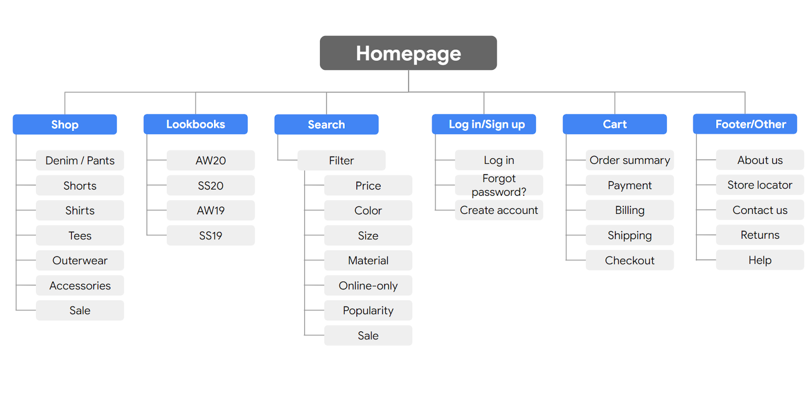
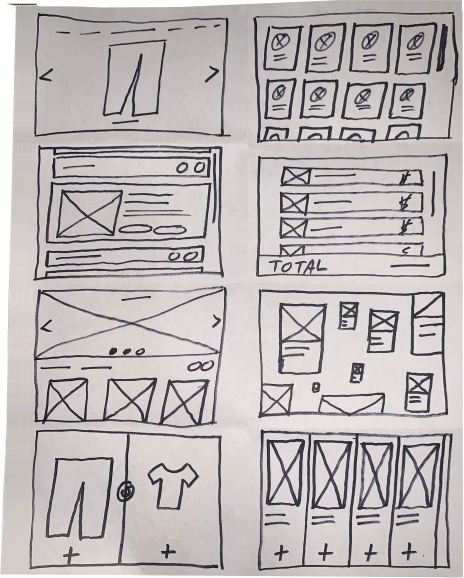

# El framework del diseño UX

## Design thinking: Un framework de diseño UX

- En el mundo del diseño de UX, un framework es una herramienta conceptual que proporciona orientación sobre las mejores prácticas y procesos para resolver problemas y construir soluciones que resuelvan los problemas de los usuarios reales.
- Los frameworks proporcionan estructura al proceso de diseño y fomentan la colaboración, lo que puede Spark innovaciones.
- La mayoría de los diseñadores de UX siguen un framework o proceso específico a la hora de enfocar su trabajo, desde la primera idea hasta el lanzamiento final de un producto.

- En este programa certificado, seguirá el marco del design thinking para secuenciar las tareas que contribuyen a los diseños que creará a lo largo del programa.
- El marco del design thinking es un enfoque de la resolución de problemas centrado en el usuario que incluye actividades como la investigación, la creación de prototipos y las pruebas para ayudarle a comprender quién es su usuario, cuáles son sus problemas y qué debe incluir su diseño.
- El design thinking framework implica las siguientes fases: empatizar, definir, idear, prototipar y probar.

- Aunque pueda parecer un proceso lineal, el marco del design thinking debe ser iterativo, lo que significa que repetirá ciertas fases a medida que perfeccione sus diseños.
- Por ejemplo, en función de los comentarios que reciba durante las pruebas, es posible que tenga que realizar investigaciones adicionales, aportar nuevas ideas o desarrollar nuevos prototipos.

- Veamos las cinco fases del framework del design thinking para saber más sobre qué actividades realizará durante cada una.
- Tenga en cuenta que el marco del design thinking, tal y como se presenta aquí, es un modelo idealizado que deben seguir los diseñadores de UX, por lo que es posible que su aplicación varíe en función de la empresa, el equipo o el proyecto.

- Empatizar
   - Durante la fase de empatía, su principal objetivo es conocer mejor al usuario y sus problemas, deseos y necesidades, así como el entorno o contexto en el que experimentará su diseño.
   - La parte más importante de la fase de empatía es alejarse de sus suposiciones y conjeturas y dejar que los resultados de su investigación informen su toma de decisiones en las fases de diseño posteriores.

   - Su investigación sobre el usuario puede incluir encuestas a los usuarios, entrevistas y sesiones de observación, y es posible que también tenga que llevar a cabo alguna investigación sobre los productos de la competencia para determinar cómo enmarca su usuario los productos de la competencia como parte de su vida cotidiana y de la resolución de problemas diarios.

- Defina
   - En la fase de definir, analizará los resultados de su investigación de la fase de empatizar y determinará qué problemas de los usuarios son los más importantes para resolver, y por qué.
   - Esto le impulsará hacia un objetivo claro para el diseño del producto.

   - El resultado más importante de esta fase es un planteamiento del problema claro, que es una descripción de la necesidad del usuario que abordarán sus diseños.
   - También puede desarrollar una propuesta de valor, que es un resumen de por qué el usuario utilizaría o debería utilizar el producto o servicio que está diseñando.

- Idear
   - Después de Conseguir un problema del usuario y establecer por qué es importante resolverlo, es el momento de la fase de ideación.
   - El objetivo de la ideación es llegar a tantas soluciones de diseño como sea posible: no se conforme con la primera porque la solución más obvia no siempre es la correcta.

   - La ideación implica una lluvia de ideas colaborativa con otros miembros de su Equipo para generar tantas soluciones como sea posible a un problema.
   - Esto podría incluir marketing, ingeniería, gestión de productos o cualquier otra parte interesada en el producto o servicio.
   - Durante las sesiones de lluvia de ideas, debe explorar todas las soluciones posibles.
   - No se centre en si algo es una idea "buena" o "mala", simplemente recopile tantas ideas como pueda.
   - Lo importante aquí es mantener este proceso libre de juicios.

   - Después de la lluvia de ideas, analizará sus posibles soluciones y empezará a elegir cuáles son las mejores opciones para perseguir como prototipos.
   - Es posible que vuelva a recurrir a la investigación de usuarios o de la competencia para ayudarle a reducir sus ideas, y también puede crear flujos de usuarios para ilustrar cómo interactuará el usuario con su solución.

- Prototipo y prueba
   - Una vez que tenga una idea de cómo resolver el problema, estará listo para entrar en la fase de prototipo, en la que su objetivo es producir un primer Modelo de producto que demuestre su funcionalidad y pueda utilizarse para las pruebas.
   - La fase de prueba es fundamental para desarrollar la solución adecuada para abordar el problema de su usuario, y un enfoque organizado de las pruebas puede ayudarle a crear experiencias de usuario excepcionales.

   - La creación de prototipos y las pruebas están interconectadas, lo que significa que pondrá a prueba sus diseños en cada fase del desarrollo del prototipo en lugar de esperar a probarlo hasta que el prototipo de trabajo esté terminado.
   - Si el diseño está demasiado pulido la primera vez que lo presenta a los usuarios, es posible que no reciba tantos comentarios.
   - Piense en formas de incluir las pruebas a lo largo del proceso de diseño, de modo que esté iterando sus diseños basándose en los comentarios de los usuarios y no en otros motivos.

   - Por ejemplo, puede poner a prueba los conceptos en los que se basa su diseño presentando a los usuarios un sencillo esquema de página o un mapa del sitio.
   - A partir de lo aprendido, puede iterar sobre ese diseño hasta llegar a un diseño más detallado en papel (conocido como prototipo de baja fidelidad) y realizar otra ronda de pruebas con los usuarios.
   - En algún momento, volverá a iterar el diseño hasta convertirlo en un modelo interactivo que funcione con un programa de software (también conocido como prototipo de alta fidelidad) y también lo probará.
   - También puede plantearse probar más de un prototipo al mismo tiempo para obtener comentarios sobre varias soluciones, o probar el mismo prototipo en varias plataformas, como un ordenador portátil, una tableta y un teléfono inteligente.

   - El objetivo de las pruebas de prototipos es seguir perfeccionando el prototipo a medida que se va conociendo si el diseño de su producto o servicio es fácil de usar y resuelve el problema del usuario.
   - En algún momento, finalizará un prototipo y se lo proporcionará a los desarrolladores, que convertirán su diseño en un producto.

- Puntos clave
   - El marco del design thinking es sólo un tipo de marco que los diseñadores de UX utilizan para organizar su enfoque de los diseños, a menudo en función del producto que estén diseñando y de la organización para la que trabajen.
   - Independientemente de los frameworks que utilicen en su carrera, todos tienen unos cuantos principios básicos en común:
      - Centrarse en el usuario.
      - Cree soluciones que aborden los problemas del usuario.
      - Colabore con compañeros de todos los departamentos.
      - Valide sus diseños.
      - Itere cuando sea necesario para diseñar la experiencia del usuario adecuada.
   - A lo largo del resto del programa de certificación, aprenderá más sobre cada una de las fases del framework del design thinking y completará actividades prácticas para adquirir más experiencia en el diseño de experiencias del usuario de principio a fin.

- Recursos para más información
   - Para más información sobre el framework del design thinking, consulte los siguientes Recursos:
      - [Design thinking 101 por Nielsen Norman Group](https://www.youtube.com/watch?v=6lmvCqvmjfE)
      - [The Design thinking Process - An Introduction (2021) por CareerFoundry](https://www.youtube.com/watch?v=Tvu34s8iMZw)
      - [Proceso de diseño de UX: Everything You Need to Know de Adobe](https://xd.adobe.com/ideas/guides/ux-design-process-steps/)
      - [¿Qué es el design thinking? de The Diseño de interacciones Foundation](https://www.interaction-design.org/literature/topics/design-thinking)

---

## Diseño de UX Requisitos de negocio (Business-to-Business)

- Ha aprendido que el design thinking es un enfoque centrado en el usuario y en varias etapas para resolver problemas.
- Su objetivo es crear productos que respondan eficazmente a las necesidades reales de los usuarios.
- Y consta de cinco fases: empatizar con los usuarios, definir sus necesidades, idear soluciones, crear prototipos de soluciones y probar esas soluciones.

- También habrá aprendido que, aunque este proceso parece ordenado y lineal, la realidad suele ser más cíclica.
- Los mejores diseñadores de UX iteran a lo largo del proceso, avanzando y retrocediendo entre etapas para hacer cosas como redefinir las necesidades de los usuarios o desarrollar prototipos alternativos.

- De hecho, en muchas situaciones del mundo real, el design thinking ni siquiera empieza con la empatía.
- En su lugar, comienza cuando un diseñador recibe el encargo de un nuevo proyecto.
- Los buenos diseñadores de UX se toman su tiempo para entender cuidadosamente estos encargos antes de seguir adelante.
- ¿Por qué? Porque la mayoría de los encargos incluyen requisitos empresariales cruciales que deben tenerse en cuenta en cada fase del proceso de design thinking.

- Requisitos de Negocio a negocio (Business-to-Business)
   - Para cualquier proyecto de diseño de UX, los requisitos empresariales proceden de la entidad que asigne el proyecto.
   - Esa entidad puede ser una empresa con ánimo de lucro, una organización sin ánimo de lucro, una organización gubernamental o cualquier otra cosa.
   - Pero independientemente de su procedencia, los requisitos empresariales suelen incluir dos tipos de información: objetivos y parámetros.
   
   - Los Objetivos de negocio suelen describir:
      - Los usuarios a los que quieren que se dirija el diseño
      - Los resultados que quieren que alcance el diseño
      - Su visión del aspecto y la funcionalidad finales del diseño
   - Los parámetros empresariales suelen describir:
      - El presupuesto, el calendario y el alcance del proyecto
      - Las Herramientas y sistemas específicos que los diseñadores deben utilizar o para los que deben diseñar
      - Los Requisitos y Estándares que debe cumplir el diseño

   - Los Requisitos empresariales varían en función del proyecto y de sus actores clave, y a menudo pueden negociarse a lo largo del ciclo de vida del proyecto.
   - Y del mismo modo que estos Requisitos pueden evolucionar a lo largo del proyecto, también deben conformar la ejecución por parte de los diseñadores del proceso de design thinking de formas poderosas.
   - En la fase de empatía, por ejemplo, los diseñadores de UX se ponen en contacto con los usuarios y recopilan información sobre sus necesidades.
   - Esta tarea cuesta tiempo y dinero, por lo que debe realizarse de forma que se ajuste al calendario y al presupuesto del proyecto.

   - He aquí un ejemplo de un diseñador de UX que se encuentra con requisitos empresariales para un nuevo proyecto.
   - A medida que aprenda sobre el design thinking en las próximas lecturas, explorará ejemplos de cómo este diseñador de UX crea un producto eficaz a la vez que satisface los Requisitos empresariales.

- Ejemplo
   - El propietario de una panadería contrata a un diseñador de UX autónomo para que le diseñe una nueva página web.
   - La panadería atiende a sus clientes exclusivamente a través de pedidos de entrega y recogida.
   - Desde su fundación hace dos años, la panadería ha hecho publicidad y ha tomado pedidos por teléfono y a través de sus cuentas en las redes sociales.
   - Este enfoque ha ayudado a la panadería a conectar directamente con los clientes y a construir una base leal sin asociarse con servicios de pedidos de terceros.

   - Pero ASÍ COMO las ventas han aumentado, el propietario y su Equipo han tenido dificultades para procesar individualmente los pedidos que llegan a través de múltiples canales.
   - Necesitan un sitio web que les ayude a mantener una conexión directa con los clientes y que, al mismo tiempo, les permita procesar los pedidos de forma más automatizada y eficaz.

   - Cuando contratan a su diseñador de UX freelance, el propietario de la panadería comparte sus objetivos y parámetros.
   - Con un presupuesto modesto y un plazo relativamente corto, quieren un sitio web sencillo que permita realizar pedidos en línea sin dirigir a los usuarios a servicios de pedidos de terceros.
   - El sitio debe ser fácil de navegar, mantener y actualizar.
   - También debe reflejar la marca existente de la panadería y atraer a sus clientes objetivo.
   - Aunque los clientes de la panadería proceden de diversos lugares y grupos demográficos, la mayoría tienen entre 35 y 70 años y viven o trabajan en la zona.

   - Estos Requisitos empresariales constituyen un punto de partida inestimable para el diseñador, que los revisa para conocer mejor a sus usuarios finales, comprender su presupuesto y sus plazos, y empezar a planificar el resto de su proceso de design thinking.

- Puntos clave
   - Aunque el design thinking comienza técnicamente con la empatía, los proyectos de diseño reales suelen empezar con los requisitos empresariales.
   - Los requisitos empresariales son objetivos y parámetros establecidos por la empresa u otra entidad que asigna el proyecto de diseño.
   - Exponen detalles cruciales como el Presupuesto de la empresa, el calendario y la visión del diseño.
   - Los diseñadores de UX eficaces comprenden estos requisitos y los tienen en cuenta en cada fase del proceso de design thinking.
   - Obtendrá más información sobre la primera fase del design thinking -y sobre cómo le dan forma los requisitos empresariales- en la siguiente lectura.   

---

## Fase 1: Empatizar con los usuarios

- Ha aprendido que los buenos diseñadores de UX tienen en cuenta los requisitos empresariales en cada fase del proceso de design thinking.
- Estos Requisitos los establece la empresa o entidad que asigna el proyecto de diseño.
- Incluyen detalles cruciales como el Cronograma, el Presupuesto y la Visión de la empresa para el producto que se está diseñando.

- Tras comprender estos requisitos, los diseñadores están listos para comenzar la primera fase del proceso de design thinking: empatizar.

- Cuando se empatiza con la gente, se intenta comprender en profundidad sus sentimientos, pensamientos y experiencias en sus propios términos, sin sesgos ni ideas preconcebidas.
- Empatizar ayuda a los diseñadores a conectar con los usuarios, no sólo como consumidores o clientes, sino como seres humanos con sus propias historias y situaciones únicas.
- Este tipo de conexión profunda ayuda a los diseñadores a crear productos que resuelven problemas reales, abordan necesidades reales y comprometen a los usuarios a largo plazo.

- Basarse en los requisitos del negocio (Business-to-Business)
   - Al empatizar, los diseñadores buscan comprender cómo experimentan los usuarios el producto que están diseñando.
   - Quieren conocer los problemas y las necesidades de sus usuarios y comprender claramente las situaciones y los entornos en los que los usuarios interactúan con el producto.
   - Cuanto mejor comprenda un diseñador estos detalles, mejor equipado estará para crear productos que satisfagan realmente las necesidades de los usuarios a largo plazo.

   - Es probable que parte de esta información sobre el usuario se incluya en los Requisitos empresariales del proyecto, pero puede estar limitada o basada en suposiciones.
   - Por eso los buenos diseñadores de UX utilizan la fase de empatía para validar, actualizar y ampliar la información del usuario en los Requisitos empresariales de su proyecto.
   - Lo hacen conectando directamente con los usuarios e investigando sus experiencias.

   - He aquí algunos métodos poderosos para empatizar con los usuarios como diseñador de UX:

      - Entrevistas
         - Las entrevistas adoptan muchas formas, pero los diseñadores de UX suelen utilizar cuatro:
            - Cuestionarios/encuestas
            - Entrevistas en persona
            - Entrevistas telefónicas
            - Entrevistas en vídeo
         - Antes de comenzar las entrevistas, los diseñadores se plantean el tipo y la cantidad de información que necesitan.
         - A continuación, los buenos diseñadores consideran los Requisitos de su negocio: ¿de cuánto tiempo, dinero y otros Recursos disponen para planificar y realizar las entrevistas?
         - Por último, los diseñadores pueden planificar entrevistas que logren el mejor equilibrio entre sus necesidades de información y los parámetros de su proyecto.
      
      - Mapas de empatía
         - Una vez que los diseñadores han realizado sus entrevistas, pueden recurrir a los mapas de empatía.
         - Éstos son una gran herramienta para procesar la información que un diseñador ha recopilado.
         - En un mapa de empatía clásico, los diseñadores se basan directamente en las entrevistas para responder a cinco preguntas sobre sus usuarios:
            - ¿Quiénes son exactamente los usuarios y cuál es su situación?
            - ¿Qué dicen los usuarios sobre sus experiencias con el producto o con productos similares?
            - ¿Qué piensan los usuarios de sus experiencias?
            - ¿Qué hacen los usuarios antes, durante y después de sus experiencias?
            - ¿Qué sienten los usuarios acerca de sus experiencias?
         - Lo ideal es que las respuestas a estas preguntas se basen en la información sobre los usuarios incluida en los requisitos empresariales del proyecto.
         - Por ejemplo, en los requisitos empresariales que exploró en la lectura anterior, el propietario de la panadería afirma que sus clientes de más edad prefieren hacer los pedidos por teléfono porque no se sienten cómodos con los formularios de pedido en línea.
         - Pero la investigación sobre UX del diseñador de UX cuenta una Historia diferente:
         - Muchos clientes mayores se sienten cómodos con los pedidos en línea pero prefieren hacerlos por teléfono porque creen que es más rápido y sienten una conexión emocional con la panadería y su personal.
         - De este modo, la investigación de empatía del diseñador ha actualizado y ampliado la información sobre el usuario en los Requisitos comerciales de la panadería.

      - Persona de usuario
         - Las personas son arquetipos ficticios que representan a grupos de usuarios similares.
         - Ayudan a los diseñadores a destilar grandes cantidades de información sobre los usuarios en trozos más manejables.
         - Por ejemplo, los clientes más antiguos de la panadería prefieren hacer sus pedidos por teléfono por una mezcla de razones.
         - Pero en lugar de intentar recordar estos detalles en abstracto, el diseñador crea un arquetipo de usuario que da vida a este cliente:
            - Berta es una clienta de edad avanzada que ha entablado relación con el personal de la panadería a lo largo del tiempo y disfruta conectando con ellos mientras hace el pedido por teléfono.
            - Además, tiene una discapacidad visual y considera que hacer el pedido por teléfono es más rápido y cómodo que hacerlo por Internet.
         - Una vez que los diseñadores han establecido los arquetipos, pueden tener presentes a sus usuarios durante todo el proceso de design thinking sin tener que recordar cada detalle que captaron durante sus entrevistas.
         - Estos arquetipos también ayudan a los diseñadores a explicar sus opciones de diseño a los clientes y a otras partes interesadas del negocio.
         - En lugar de intentar describir a sus usuarios en abstracto, utilizan los arquetipos de usuario para contar historias convincentes que ponen sus diseños en contexto.

- Puntos clave
   - En la fase de empatía del design thinking, los diseñadores tratan de comprender a sus usuarios a través de una serie de métodos de investigación, como entrevistas, mapas de empatía y personajes de usuario.

   - El objetivo de empatizar es comprender los problemas, los deseos, las necesidades y las situaciones de los usuarios para diseñar un producto que funcione para ellos y cree una experiencia agradable.
   - A lo largo de esta fase, los buenos diseñadores de UX intentan comprender a los usuarios tan profundamente como pueden sin dejar de trabajar dentro de los requisitos clave del negocio, como el calendario y el Presupuesto.

---

## Fase 2: Definir las necesidades de los usuarios

- Ha aprendido que los diseñadores de UX eficaces suelen comenzar el proceso de design thinking sólo después de haber comprendido los objetivos, parámetros y otros requisitos empresariales de su proyecto.
- También ha aprendido sobre la primera fase del proceso de design thinking: empatizar.
- Empatizar consiste en conectar con los usuarios, recopilar información sobre ellos y destilar esa información en arquetipos de usuario detallados.

- Tras empatizar, los diseñadores pasan a la siguiente fase del design thinking: definir.
- En la fase de definir, los diseñadores analizan su trabajo de empatía para responder a esta pregunta clave:
- ¿Cuáles de las necesidades o problemas de mis usuarios son los más importantes para que mi diseño los aborde?
- Normalmente, los diseñadores utilizan una combinación de herramientas para responder a esta pregunta.

- Historias de usuario
   - Mientras que un personaje de usuario destila un gran grupo de usuarios similares en un único arquetipo, las historias de usuario ayudan a los diseñadores a centrar aún más su comprensión de esos usuarios.
   - Una historia de usuario es una narración de una sola frase contada desde la perspectiva de un personaje.
   - Debe encapsular quién es el usuario, qué quiere hacer y por qué quiere hacerlo.
   - A continuación se ofrece una plantilla sencilla para redactar una historia de usuario:
      - Como [tipo de usuario], quiero [acción] para que [beneficio].
   
   - Cuando se hace bien, una historia de usuario proporciona al diseñador información que puede utilizar para crear una lista de comprobación a la que puede volver a medida que define las necesidades de sus usuarios e idea soluciones eficaces.
   - Por ejemplo, recuerde a Berta, uno de los arquetipos de usuario del ejemplo de la panadería que ha estado explorando.
   - Para Berta, el diseñador de UX podría desarrollar una Historia de usuario como ésta:
      - Como clienta de hace mucho tiempo con una discapacidad visual y una estrecha relación con el personal de la panadería, quiero hacer mis pedidos por teléfono para poder pedir con facilidad y seguir conectando con los miembros del personal.

- Recorridos del usuario
   - Una vez que el diseñador ha destilado sus grupos de usuarios en personas e historias realistas, es hora de empezar a trazar el recorrido del usuario de cada persona.
   - Un recorrido del usuario es una serie de experiencias que el usuario tiene mientras intenta alcanzar su objetivo.
   - Puede ser una experiencia que tienen con el producto que se está diseñando, una experiencia que tienen con un producto similar o una experiencia que tienen en ausencia de esos productos.

   - En el desarrollo de la nueva página web de la panadería, por ejemplo, el diseñador de UX crea dos recorridos del usuario para cada persona, incluida Berta.
   - Uno de los recorridos del usuario de Berta refleja cómo interactúan normalmente los usuarios como ella con la panadería y sus sistemas de pedido actuales (una mezcla de pedidos por teléfono y mensajes directos en cuentas de Redes sociales).
   - El otro recorrido del usuario refleja cómo interactúan normalmente los usuarios como Berta con los sistemas de pedido basados en la web, que es el tipo de producto que está creando el diseñador.

- Planteamiento del problema
   - Con recorridos del usuario completos para cada arquetipo, un diseñador puede identificar mejor los problemas que su diseño debe resolver o las necesidades que su diseño debe abordar.
   - A continuación, pueden destilar estos problemas o necesidades en planteamientos del problema.

   - Un planteamiento del problema resume quién es el usuario, qué necesita de un diseño y por qué.
   - A continuación se ofrece una plantilla sencilla para redactar el planteamiento del problema:
      - [Nombre de la persona de usuario] es un [tipo de usuario] que necesita [tipo de experiencia del usuario] porque [beneficios de la experiencia del usuario].

   - Esta plantilla es similar a una historia de usuario, pero los planteamientos del problema suelen ser más detallados y se escriben desde la perspectiva del diseñador.
   - Por ejemplo, he aquí un planteamiento del problema para Berta:
      - Berta es una persona mayor con discapacidad visual.
      - Es clienta de una panadería desde hace mucho tiempo y prefiere hacer sus pedidos por teléfono.
      - Necesita un sitio web y un sistema de pedidos en línea que sean fáciles de usar, se adapten a sus necesidades visuales e imiten la sensación y el flujo de una conversación telefónica cordial.
      - Quiere hacer sus pedidos con facilidad y sentir que está estableciendo una conexión personal con la panadería.

   - Los diseñadores de UX eficaces crean planteamientos del problema para cada uno de sus usuarios.
   - Esto ayuda a los diseñadores a crear productos que respondan a las necesidades de múltiples tipos de usuarios en lugar de atender únicamente a un tipo de usuario.

- Puntos clave
   - En la fase de definición del design thinking, los diseñadores se basan en sus requisitos empresariales y en su trabajo de empatía para enunciar una serie de problemas específicos que quieren que aborde su diseño.
   - Estos problemas deben surgir de un conocimiento profundo de quiénes son los usuarios y de cómo experimentan el producto, incluidas las tareas específicas a las que se enfrentan y los sentimientos que aportan a esas tareas, como hacer pedidos en una panadería.

---

## Fase 3: Idear soluciones

- En la segunda fase del design thinking, los diseñadores se basan en su investigación de empatía para definir y seleccionar los problemas de los usuarios que deben abordar.
- En la tercera fase, idean posibles soluciones a esos problemas.

- En la fase de ideación se trata de ser creativos y de hacer una lluvia de ideas con muchas soluciones potenciales.
- Los diseñadores suelen colaborar con los miembros del Equipo, las partes interesadas del negocio y los usuarios potenciales.
- Sus ideas pueden ser inesperadas o fuera de lo común, ¡y eso es genial!

- Al principio de la fase de ideación, los buenos diseñadores intentan suspender sus suposiciones, ideas preconcebidas y juicios:
- El objetivo es proponer, considerar y cuestionar tantas alternativas como sea posible sin evaluar ni seleccionar ninguna.
- La Evaluación y la Selección llegan más tarde, en la fase de ideación:
- Una vez que hay muchas ideas sobre la mesa, los diseñadores tienen más posibilidades de comparar alternativas y seleccionar la mejor.

- Como aprenderá en un curso posterior, existen muchísimas técnicas diferentes para el brainstorming, y los mejores diseñadores de UX eligen, adaptan y crean nuevas técnicas según sea necesario.
- Por ahora, he aquí algunas de las más comunes:
   
- "¿Cómo podríamos?"
   - En este ejercicio de lluvia de ideas, los diseñadores toman el planteamiento del problema de la fase de definición y lo convierten en una lista de preguntas que empiezan por "¿Cómo podríamos?", o HMW.
   - Las preguntas HMW ayudan a los diseñadores a replantear los problemas de los usuarios como interesantes oportunidades de solución.
   - Por ejemplo, recuerde el planteamiento del problema que exploró en la lectura anterior en la que se definían las necesidades de los usuarios:
      
   - Berta es una persona mayor con discapacidad visual.
   - Es clienta de una panadería desde hace mucho tiempo y prefiere hacer sus pedidos por teléfono.
   - Necesita un sitio web y un sistema de pedidos en línea que sean fáciles de usar, se adapten a sus necesidades visuales e imiten la sensación y el flujo de una conversación telefónica cordial.
   - Quiere hacer sus pedidos con facilidad y sentir que está estableciendo una conexión personal con la panadería al hacer sus pedidos.

   - Si el diseñador de UX de la panadería replanteara este planteamiento del problema como una serie de preguntas HMW, éstas podrían incluir:
      - ¿Cómo podemos hacer que el proceso de pedido en línea sea fácil de usar?
      - ¿Cómo podríamos hacer que el sistema de pedidos en línea imitara una conversación amistosa?
      - ¿Cómo podríamos asegurarnos de que el sistema de pedidos en línea se adapta a las necesidades visuales de Berta?
   - Después de crear estas preguntas HMW, los buenos diseñadores de UX dedican tiempo a responderlas con tantas soluciones posibles como se les ocurran, ¡y no se contienen!

- Sketch rápido
   - Mientras que "¿Cómo podríamos?" se centra en preguntas y soluciones escritas, el esbozo rápido es un enfoque visual de la ideación.
   - (El boceto rápido es especialmente útil cuando los diseñadores necesitan una lluvia de ideas sobre los elementos visuales de un nuevo diseño.
   - En primer lugar, los diseñadores aclaran el problema que intentan resolver o la idea que pretenden iterar.
   - Pueden utilizar una de las preguntas o soluciones que desarrollaron en un ejercicio de HMW.
   - A continuación
      1. Dividen una hoja de papel grande en ocho cuadrados.
      2. Tomen algo con lo que dibujar.
      3. Pongan en marcha un cronómetro de ocho minutos.
      4. Tómense un minuto para esbozar una idea o solución en cada cuadrado.

   - Cuando suene el cronómetro de ocho minutos, deberá haber un esbozo diferente en cada uno de los ocho cuadrados del papel.
   - Los diseñadores pueden adaptar este planteamiento según sus necesidades.
   - Por ejemplo, si un diseñador dispone de menos tiempo o de hojas de papel más pequeñas, podría empezar con cuatro cuadrados y cuatro minutos para esbozar.

- Auditorías competitivas
   - Cuando los diseñadores quieren nuevas ideas sobre cómo resolver un problema, también pueden auditar a sus competidores haciéndose preguntas como las siguientes
      - ¿Qué productos ofrecen?
      - ¿Cuáles son los puntos fuertes y las áreas de mejora de esos productos?
   - Respondiendo a preguntas como éstas, los diseñadores pueden inspirarse para sus propios diseños, identificar lagunas en el mercado y encontrar pruebas de qué diseños han funcionado ya y cuáles no.
   - Con las auditorías, los diseñadores pueden ahorrar tiempo, dinero y esfuerzo aprendiendo de los competidores que ya han diseñado productos similares o han intentado resolver problemas parecidos.

- SCAMPER
   - SCAMPER es una técnica que utilizan los diseñadores para realizar lluvias de ideas sobre cambios y alternativas a ideas y diseños.
   - Cada letra del acrónimo representa una acción diferente que los diseñadores pueden aplicar a sus diseños, como sustituir elementos (S) por otros elementos, combinar elementos (C) en uno solo o adaptar elementos (A) con alternativas.
   - En su totalidad, las siglas significan: Sustituir, Combinar, Adaptar, Modificar, Dar otro uso, Eliminar y Reorganizar.

- Colaboración
   - La ideación suele funcionar mejor cuando es colaborativa.
   - Los equipos de diseño eficaces suelen idear juntos en sesiones de trabajo colaborativo.
   - Y tanto si trabajan solos como en equipo, los diseñadores suelen incorporar a otros actores al proceso de ideación, incluidos sus usuarios y las partes interesadas de su empresa.

   - Antes de poner en marcha una asociación o sesión de trabajo en colaboración, los diseñadores o equipos de diseño eficaces suelen asegurarse de que han respondido a preguntas cruciales como:
      - ¿Quién participará? ¿Cuáles serán sus funciones?
      - ¿Dónde tendrá lugar la colaboración? ¿Será presencial o virtual?
      - ¿Por qué se produce la colaboración? ¿Cuál es el objetivo final?
      - ¿Cómo se llevará a cabo la colaboración? ¿Qué Herramientas y procesos utilizaremos?

- Requisitos de Negocio a negocio (Business-to-Business)
   - Las técnicas de ideación ayudan a los diseñadores a aportar muchas ideas, pero ¿cumplirán esas ideas los requisitos empresariales de su proyecto?
   - A medida que los diseñadores revisan sus ideas, deben referirse a sus requisitos empresariales y plantearse preguntas como éstas:
      - ¿Cuál de estas ideas será factible dentro del Presupuesto y el Cronograma del proyecto?
      - ¿Cuál de estas ideas cumplirá mejor los Estándares del diseño?

   - Aunque la ideación comienza con la exploración de posibilidades ilimitadas, siempre habrá parámetros firmes para un proyecto.
   - Los buenos diseñadores de UX suelen intentar enmarcar estos parámetros de forma positiva:
   - Son obstáculos que inspiran la resolución creativa de problemas, barandillas que mantienen el proceso de diseño en el buen camino y filtros para cribar todas esas posibilidades ilimitadas.

- Claves
   - En la fase de ideación del design thinking, los diseñadores de UX realizan una lluvia de ideas con muchas soluciones posibles para los problemas de los usuarios que han identificado.
   - Utilizan técnicas de lluvia de ideas e investigación como "¿Cómo podríamos?" (HMW), Rapid Sketch, auditorías competitivas y SCAMPER.
   - Debe ser un proceso divertido, creativo y libre de juicios: Cuantas más ideas, ¡mejor!
   - Pero una vez que las ideas están ahí fuera, los buenos diseñadores de UX se toman su tiempo para cotejar las posibles soluciones con los Requisitos empresariales de su proyecto.
   - En última instancia, su objetivo es elegir la solución que satisfaga los Requisitos y, al mismo tiempo, funcione mejor para los usuarios.

---

## Fase 4: Soluciones prototipo

- Cuando un diseñador ha empatizado con sus usuarios, ha definido sus necesidades y ha ideado soluciones, es el momento de iniciar la cuarta fase del design thinking: la creación de prototipos de soluciones.

- En la fase de creación de prototipos, el objetivo no es construir un producto final.
- Más bien, los diseñadores producen modelos iniciales, o prototipos, de la solución para que puedan ver cómo será y cómo funcionará para los usuarios.
- Los prototipos también muestran a las partes interesadas y a los usuarios potenciales lo que puede hacer el diseño.
- Entonces, ¿cómo elaboran prototipos los diseñadores?
- Hay muchas prácticas que pueden utilizar.

- Arquitectura de la información y mapas del sitio
   - Para satisfacer las necesidades de los usuarios, los productos como las aplicaciones web deben presentar la información de forma que los usuarios puedan comprenderla y navegar por ella con facilidad y placer.
   - Cuando los diseñadores organizan la información de un producto, crean algo llamado "arquitectura de la información" o AI.
   - La arquitectura de la información es esencialmente un diagrama o diagrama de flujo de alto nivel que muestra cómo los usuarios pueden moverse por un producto, como un sitio web o una aplicación.
   - Al planificar la arquitectura de la información de un producto, los diseñadores suelen crear algo llamado mapa del sitio, como éste para un sitio web:

   - Como toda buena arquitectura de la información, este mapa del sitio organiza el producto esbozando su jerarquía y secuencia:
      - La jerarquía se refiere a cómo se priorizan y subordinan los temas.
      - Las jerarquías enfatizan los temas más amplios o importantes, que a su vez contienen temas más pequeños o menos importantes.
      - En el mapa del sitio anterior, por ejemplo, "Tienda" es un tema principal que contiene temas más pequeños, como "Vaqueros/Pantalones"

      - La secuencia se refiere al orden en el que los usuarios pueden navegar por la jerarquía del producto, como navegar de la "Página de inicio" a la "Tienda" a "Vaqueros/Pantalones" y así sucesivamente.

   - La arquitectura de la información y los mapas del sitio son cruciales para satisfacer las necesidades de los usuarios.
   - Por ejemplo, recordemos al diseñador que está desarrollando una página web y un sistema de pedidos en línea para una panadería.
   - Una de las personas de usuario del diseñador es un cliente mayor que prefiere hacer pedidos por teléfono porque le gusta hablar con el personal de la panadería.

   - Así pues, el diseñador pretende crear un sitio web y un sistema de pedidos que repliquen la experiencia de pedir por teléfono.
   - El éxito del diseño dependerá en gran parte de su arquitectura de la información.
   - Al crear el mapa del sitio web, por ejemplo, el diseñador utiliza la jerarquía y luego secuencia la información para que los usuarios entren en la página de inicio e inmediatamente vean una opción para "Hacer un pedido", igual que podrían ser invitados a hacer un pedido después de ser recibidos por el personal de la panadería por teléfono.

- Esquemas de página
   - Los wireframes son esbozos del producto que dan vida al mapa del sitio.
   - Los diseñadores los utilizan para averiguar cómo están dispuestas las páginas del producto, cómo se organizan los elementos de cada página y cómo progresarán los usuarios de una página a otra.
   - Son relativamente sencillos y consisten principalmente en formas, líneas y un texto mínimo.
   - Los diseñadores pueden emplear dos Métodos:

- Esquemas de página en papel
   - Los wireframes en papel son esquemas de página.
   - Utilizan líneas horizontales para representar texto, rectángulos o cajas para representar iconos o imágenes, y otras formas para representar botones y elementos adicionales.
   - Es fácil y barato iterar muchas versiones con papel.

- Esquemas de página digitales
   - Los esquemas de página digitales se desarrollan en una herramienta de diseño de UX como Figma o Adobe XD.
   - Los wireframes digitales son diseños en 2D que muestran, a un alto nivel, el aspecto que tendrá el producto.
   - Los diseñadores utilizan la escala de grises, las formas y el texto de marcador de posición para demostrar el aspecto que tendrá el diseño cuando se añada el contenido.
   - (Como nota al margen divertida: Lorem ipsum es una forma de texto de marcador de posición tan común que a muchos diseñadores les gusta jugar con él por diversión, para inspirar la creatividad.
   - Eche un vistazo a [Meet the Ipsums](https://meettheipsums.com/) para explorarlo)

- Prototipos de baja fidelidad (lo-fi)
   - En UX, "fidelidad" significa lo mucho que se ajusta un diseño al aspecto y la sensación del producto final.
   - Un prototipo de baja fidelidad es un Modelo interactivo sencillo que proporciona una idea básica del aspecto que tendrá el producto y de cómo fluirán sus componentes para los usuarios.
   - Los diseñadores suelen crear prototipos de baja fidelidad ensamblando sus esquemas de página y añadiendo interactividad, o la posibilidad de navegar de una pantalla a otra.
   - Los diseñadores utilizan prototipos de baja fidelidad para probar y mejorar sus diseños antes de dedicar tiempo y esfuerzo a desarrollar prototipos de alta fidelidad más detallados.

- Prototipos de alta fidelidad (hi-fi)
   - Un prototipo de alta fidelidad toma el prototipo de baja fidelidad y lo acerca lo más posible al producto final.
   - Los prototipos de alta fidelidad incorporan todos los componentes, la interactividad y el contenido del producto, aunque parte del contenido puede estar representado por marcadores de posición realistas.
   - No es el producto final, pero permite que la gente experimente más plenamente el aspecto, el tacto y el funcionamiento del producto.
   - Por ejemplo, considere el prototipo de alta fidelidad ricamente detallado para Tee's Shirts que aparece a continuación.
   - Más que un simple conjunto de esquemas de página navegables, este prototipo de alta fidelidad permitirá a los probadores y a las partes interesadas simular una experiencia realista con el producto final, lo que significa comentarios más ricos y detallados para los diseñadores sobre cada faceta del producto final.

   - Durante la creación de prototipos, ya sean de baja fidelidad o de alta fidelidad, los diseñadores suelen revisar la información y las decisiones de fases anteriores del proceso de design thinking.
   - Al evaluar los prototipos, por ejemplo, deben preguntarse si la disposición, el flujo, el aspecto y el tacto responden al planteamiento del problema desarrollado durante la fase de definición.
   - ¿Podría Berta, el arquetipo de cliente de panadería que conoció antes, utilizar fácilmente el sitio para hacer un pedido?
   - ¿Le ofrece el sitio la experiencia personal a la que está acostumbrada y que busca?
   - Todas estas son cosas que el diseñador de UX de la panadería debe tener en cuenta cuando eche un vistazo crítico a los prototipos.

- Creación de prototipos y pruebas
   - Habrá leído que los diseñadores crean prototipos para que la gente pueda experimentar el aspecto y el tacto del producto.
   - Si piensa que eso suena a pruebas, la siguiente fase del proceso de design thinking, entonces está en lo cierto: la creación de prototipos y las pruebas están profundamente interconectadas.
   - En la siguiente lectura, verá cómo estas fases trabajan en tándem.
   - ¡Siga explorando para descubrir qué ocurre a continuación!

- Puntos clave
   - El design thinking consta de cinco fases: empatizar, definir, idear, prototipar y probar.
   - Se trata de un proceso cíclico e iterativo que requiere que los diseñadores de UX vuelvan a visitar las distintas fases según sea necesario.
   - En la fase de prototipo, los diseñadores de UX crearán un Modelo del producto.
   - Para ello, utilizarán diversas prácticas como:
      - Arquitectura de la información
      - Mapas del sitio
      - Esquemas de página (en papel y digitales)
      - Prototipos de baja fidelidad
      - Prototipos de alta fidelidad
   - El objetivo de la creación de prototipos es disponer de un Modelo para probarlo y obtener comentarios al respecto.
   - Las fases de creación de prototipos y de prueba del design thinking funcionan en tándem.

---

## Fase 5: Soluciones de prueba

- Una vez que los diseñadores han construido un prototipo, es hora de probarlo.
- La prueba es la quinta fase del proceso de design thinking.
- Y, como ya ha aprendido, las pruebas suelen producirse en ciclos con la creación de prototipos.

- Piense en el ejemplo de la panadería de las lecturas anteriores.
- El diseñador de UX organizó el contenido y los elementos visuales del sitio web con una arquitectura de la información y un mapa del sitio.
- A continuación, pasaron por iteraciones de esquemas de página, creando finalmente un prototipo de baja fidelidad y luego un prototipo de alta fidelidad.

- En algún momento de la fase de creación de prototipos, los diseñadores suelen empezar a probar sus prototipos y a introducir mejoras.
- Unas pruebas eficaces pretenden revelar lo que piensan, sienten y experimentan los usuarios al utilizar un producto, como una página web o una aplicación.
- Para obtener resultados ricos e imparciales, las buenas pruebas comienzan con un plan.
- Exploremos brevemente los elementos clave de las pruebas de UX considerando el quién, qué, cuándo, dónde, por qué y cómo de un plan de pruebas:

   - ¿Quién participará en las pruebas?
      - Al principio, los diseñadores pueden pedir a amigos, colegas, socios de diseño u otros participantes informales que prueben un producto y ofrezcan comentarios.
      - Más adelante, los participantes ideales incluyen usuarios de la vida real que se alineen con los arquetipos de usuario del proyecto.

   - ¿Qué tipos de pruebas se llevarán a cabo?
      - En los próximos cursos, aprenderá más sobre los distintos tipos de investigación sobre UX y las pruebas de UX, incluidos los tipos de información que ayudan a recopilar a los diseñadores.

   - ¿Cuándo y dónde se realizarán las pruebas?
      - Las pruebas pueden realizarse en persona o virtualmente, en distintos entornos o canales de comunicación.
      - Todo depende: Los buenos diseñadores de UX planifican pruebas que logran el mejor equilibrio entre sus necesidades y los Requisitos empresariales de su proyecto.

   - ¿Por qué se realizan las pruebas?
      - Las pruebas de UX se realizan por una serie de razones, pero el objetivo principal es siempre comprender a los usuarios y mejorar sus experiencias.
      - Durante la fase de prueba del design thinking, algunas de las razones más comunes para realizar pruebas son:
         - Validar ideas, Información o decisiones de otras partes del proceso de design thinking, como la información sobre el usuario generada durante la fase de empatía o las decisiones de diseño tomadas durante la ideación.
         - Descubrir problemas de usabilidad para abordarlos en posteriores iteraciones y prototipos. Los usuarios experimentan estos problemas como puntos de dolor que les impiden utilizar el producto y alcanzar sus objetivos con facilidad y disfrute.
   
   - ¿Cómo se involucrarán los participantes con el prototipo?
      - Aquí, una consideración clave es si el propio proceso de prueba es inclusivo y accesible para todos los participantes.
      - Como aprenderá, las pruebas eficaces incorporan tecnologías de accesibilidad y otros elementos inclusivos para garantizar que todos los participantes puedan implicarse plenamente.

   - ¿Cómo se recopilará la Información?
      - Los diseñadores utilizan una serie de métodos para recopilar información de los usuarios, como la observación y las entrevistas.
      - También pueden recopilar información del propio prototipo o de los sistemas que utilizan los participantes para interactuar con el prototipo.

- En el caso de la panadería, el diseñador de UX probó un prototipo de baja fidelidad y luego un prototipo de alta fidelidad con una serie de usuarios que se ajustaban a las personas de usuario clave del proyecto, incluida Berta.
- A través de los comentarios de los usuarios, el diseñador descubrió formas clave de mejorar el sitio web y satisfacer mejor las necesidades de los usuarios.
- Con algo de tiempo y más iteraciones, el diseñador acabó creando un diseño satisfactorio que satisfacía los Requisitos empresariales de su cliente y, al mismo tiempo, creaba una experiencia fácil y agradable para los usuarios.
- Y ahora, ¡a por unos pastelitos!

- Puntos clave
   - En la fase de prueba, el objetivo es perfeccionar el prototipo a medida que los diseñadores obtienen estadísticas sobre si resuelve o no el problema definido.
   - Una vez realizadas las pruebas, se finalizará el prototipo y éste pasará a los desarrolladores, que convertirán el diseño en el producto real.  